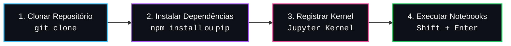

# 📊 Guia Completo de Execução do Ambiente


Bem-vindo ao repositório de **Data Science e Big Data na Indústria**! Este guia fornece instruções passo a passo para clonar, configurar e executar todos os notebooks interativos do curso de forma prática, rápida e automatizada.

---

## 🧭 Visão Geral do Fluxo de Configuração

Configurar o ambiente leva menos de 2 minutos. Veja o fluxo visual resumido em 3 passos:




---

## 📋 Pré-requisitos do Sistema

Antes de começar, certifique-se de ter instalado em sua máquina:

| Ferramenta | Versão Recomendada | Função |
| :--- | :--- | :--- |
| **Python** | `3.10` a `3.13` | Motor de execução de Data Science |
| **Node.js & npm** | `v18+` (Opcional) | Automação de setup em comando único |
| **VS Code / IDE** | Atualizada | Ambiente de desenvolvimento interativo |
| **Git** | Qualquer versão recente | Controle de versão e clonagem |

> [!TIP]
> O Node.js/npm é opcional se você preferir usar comandos nativos do Python (`pip`). No entanto, o `npm install` automatiza tanto a instalação dos pacotes quanto o registro do Kernel do Jupyter com apenas um comando!

---

## 🚀 Método 1: Configuração Automatizada via `npm` (Recomendado)

Se você já utiliza Node.js/npm no seu dia a dia, este é o método mais rápido:

### Passo 1: Clonar e acessar o repositório
Abra o terminal e execute:
```bash
git clone https://github.com/carloska24/DataScience-BigData.git
cd DataScience-BigData
```

### Passo 2: Executar o `npm install`
Na raiz do projeto (ou dentro da pasta `Aula3`), execute:
```bash
npm install
```

> [!NOTE]
> **O que acontece por trás dos panos?**  
> O script `postinstall` configurado no `package.json` executará automaticamente:
> 1. `pip install -r requirements.txt` (baixa e instala todas as bibliotecas de ciência de dados).
> 2. `python -m ipykernel install --user --name=datascience --display-name "Python (Data Science)"` (registra o Kernel no Jupyter do seu sistema).

### Passo 3: Validar a saúde do ambiente
Para confirmar que tudo foi instalado com sucesso, execute:
```bash
npm run test:env
```
Se tudo estiver correto, você verá a mensagem:  
`Ambiente OK!`

---

## 🐍 Método 2: Configuração Nativa em Python (`pip` e `venv`)

Se você prefere o fluxo tradicional de desenvolvedores Python usando um ambiente virtual isolado:

### Passo 1: Criar e ativar o Ambiente Virtual

* **No Windows (PowerShell):**
  ```powershell
  python -m venv .venv
  .\.venv\Scripts\Activate.ps1
  ```
* **No Linux / macOS (Bash/Zsh):**
  ```bash
  python3 -m venv .venv
  source .venv/bin/activate
  ```

### Passo 2: Instalar as bibliotecas
```bash
pip install -r requirements.txt
```

### Passo 3: Registrar o Kernel no Jupyter
```bash
python -m ipykernel install --user --name=datascience --display-name "Python (Data Science)"
```

---

## 🧩 Extensões Recomendadas para o VS Code

Ao abrir a pasta no VS Code ou Antigravity IDE, uma notificação aparecerá no canto inferior direito recomendando as extensões listadas em `.vscode/extensions.json`:

* **Python** (`ms-python.python`): Suporte completo a depuração e interpretação Python.
* **Pylance** (`ms-python.vscode-pylance`): Autocomplete, linting e type-checking ultra rápido.
* **Jupyter** (`ms-toolsai.jupyter`): Permite visualizar, editar e rodar arquivos `.ipynb`.
* **Jupyter Notebook Renderers** (`ms-toolsai.jupyter-renderers`): Renderização interativa de gráficos, tabelas e visualizações ricas.

> [!IMPORTANT]
> Caso a notificação não apareça, pressione `Ctrl + Shift + X`, digite `@recommended` na barra de pesquisa de extensões e clique em **Instalar Tudo**.

---

## 📓 Como Executar os Notebooks (.ipynb)

1. No explorador de arquivos, abra o notebook desejado, por exemplo:  
   `Aula3/Aula03_Todos_os_Exemplos_Completo.ipynb`
2. No canto superior direito da janela do notebook, clique no seletor de **Kernel**:
   * Escolha **Python Environments...** ou **Jupyter Kernel...**
   * Selecione **Python (Data Science)** ou o interpretador Python onde os pacotes foram instalados.
3. Para executar uma célula:
   * Pressione **`Shift + Enter`** (executa a célula atual e avança para a próxima).
   * Ou clique no botão de **Play (▶)** ao lado esquerdo da célula de código.
4. Para rodar o notebook inteiro de uma vez, clique em **Run All** (Executar Todas) na barra de ferramentas superior do notebook.

---

## 📦 Bibliotecas Instaladas no Projeto

Todas as bibliotecas listadas abaixo são gerenciadas pelo arquivo [requirements.txt](requirements.txt):

| Biblioteca | Versão Mínima | Finalidade no Curso |
| :--- | :--- | :--- |
| **`pandas`** | `2.2.0` | Leitura de CSVs, limpeza de dados, criação de DataFrames |
| **`numpy`** | `2.0.0` | Computação numérica, vetores e matrizes |
| **`matplotlib`** | `3.9.0` | Criação de gráficos estáticos (boxplots, histogramas, dispersões) |
| **`scikit-learn`** | `1.5.0` | Algoritmos de Machine Learning (Árvores de Decisão, Random Forest, pipelines) |
| **`ipykernel`** | `6.29.0` | Conexão do backend Python com as células do Jupyter |
| **`IPython`** | `8.20.0` | Recursos ricos de exibição (`display()`, formatação interativa) |

---

## 🛠️ Comandos e Scripts Úteis

Você pode utilizar os seguintes atalhos no terminal:

```bash
# Executa a instalação de dependências e registro do Kernel
npm install

# Testa rapidamente se todos os módulos estão importando sem erro
npm run test:env

# Inicia o servidor local clássico do Jupyter Notebook no navegador
npm start
```

---

## ❓ Resolução de Problemas (Troubleshooting)

### 1. "O Kernel `Python (Data Science)` não aparece no VS Code"
* **Solução**: Pressione `Ctrl + Shift + P` no VS Code, digite `Jupyter: Filter Kernels` e verifique se o kernel `datascience` está habilitado. Você também pode registrar novamente rodando:
  ```bash
  python -m ipykernel install --user --name=datascience --display-name "Python (Data Science)"
  ```

### 2. "Erro de execução de scripts no PowerShell (ExecutionPolicy)"
* **Solução**: Abra o terminal do PowerShell e rode o comando para permitir scripts locais:
  ```powershell
  Set-ExecutionPolicy -Scope CurrentUser -ExecutionPolicy RemoteSigned
  ```

### 3. "FileNotFoundError: Coloque consumo_energetico_alunos.csv na pasta atual"
* **Solução**: Certifique-se de que o diretório de trabalho do notebook está apontando para a pasta onde o CSV se encontra (`Aula3/`), ou abra a pasta `Aula3` diretamente no editor.

---

> ✨ **Dica de Estudos**: Mantenha o terminal integrado aberto (`Ctrl + '`) para acompanhar saídas de scripts e instalar bibliotecas extras quando necessário!
