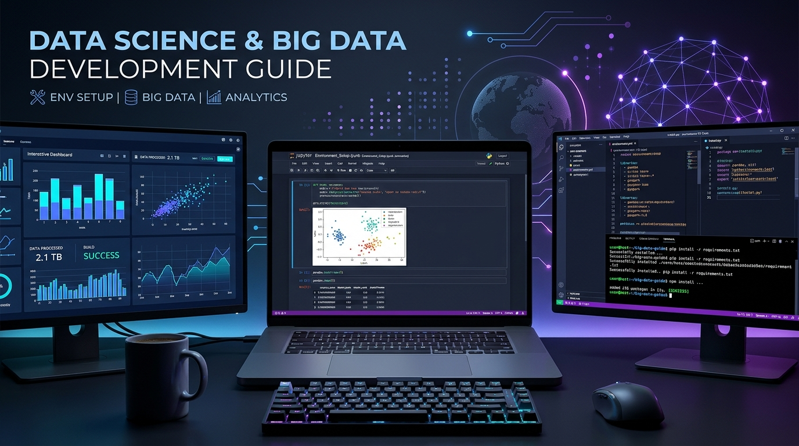

# Data Science & Big Data

Materiais de **Data Science e Big Data na Indústria** e **Python para Data Science**. O repositório reúne aulas em PDF, notebooks de referência do professor, exercícios resolvidos e um estudo aplicado de falhas em equipamentos industriais.

[Materiais e exercícios](#materiais-e-exercicios) · [Projeto de manutenção industrial](#projeto-de-manutencao-industrial) · [Como executar](#como-executar)

<a id="materiais-e-exercicios"></a>
## Materiais e exercícios

Os [PDFs de Data Science e Big Data na Indústria](PDFS%20AULAS/) cobrem as aulas 01 a 05. Os [notebooks do professor](Codigos%20do%20Professor/) incluem exemplos das aulas 03 e 05.

| Aula | Conteúdo | Arquivos |
| --- | --- | --- |
| [Aula 02](Aula02/) | Pandas e análise exploratória de dados de produção, energia, transporte, vendas e manutenção | [Notebook completo](Aula02/Aula02_Todos_os_Exemplos_Completo.ipynb) · [Exercícios resolvidos](Aula02/Exercicios%20Aula02/Carlos_Pereira_Exercicios_Aula_02.ipynb) · [Dados](Aula02/dados/) |
| [Aula 03](Aula03/) | Análise de consumo energético | [Notebook completo](Aula03/Aula03_Todos_os_Exemplos_Completo.ipynb) · [Entrega para Colab](Aula03/Entrega%20Colab%20Aula03/Carlos_Pereira_Aula03_Exercicios_Resolvidos_Colab.ipynb) · [Dados](Aula03/consumo_energetico_alunos.csv) |
| [Aula 05](Aula05/) | K-Means, padronização de variáveis e método do cotovelo | [Agrupamento de viagens](Aula05/Exercicio01_Aula05.ipynb) · [Agrupamento de máquinas](Aula05/Exercicio02_Aula05.ipynb) |
| [Aula 06](Aula06/) | Aula 01 de **Python para Data Science**, com notebooks e scripts Python | [PDF](Aula06/Aula%2001%20-%20Python%20para%20Data%20Science.pdf) · [Temperatura de máquina](Aula06/Exercicio01_Aula06.ipynb) · [Vendas](Aula06/Exercicio02_Aula06.ipynb) · [Preços de ações](Aula06/Exercicio03_Aula06.ipynb) |

<a id="projeto-de-manutencao-industrial"></a>
## Projeto de manutenção industrial

O estudo da **S&M Industry Tech** investiga condições associadas a falhas em cinco máquinas. A base original tem 5.050 registros. Após remover 50 duplicatas exatas, restam 5.000 registros, dos quais 903 têm falha (18,06%).

1. Explorar temperatura, vibração, pressão, corrente elétrica e horas de operação. Na preparação, verificar datas e valores ausentes e sinalizar medições extremas.
2. Classificar a ocorrência de falha no próprio registro. Comparar Árvore de Decisão, Random Forest e Regressão Logística com uma referência majoritária, usando divisão temporal de aproximadamente 60% para treino, 20% para validação e 20% para teste.
3. Identificar perfis operacionais com K-Means a partir das variáveis operacionais. Calcular a taxa de falhas de cada grupo após o agrupamento.
4. Reproduzir operações de leitura, filtragem e agregação com PySpark local e conferir os resultados com Pandas.

### Resultados

A **Random Forest** foi escolhida pelo maior F1 na validação. No teste final, com 1.000 registros, obteve **82,50% de acurácia, 58,44% de precisão, 23,94% de recall e F1 de 0,340**. Detectou 45 das 188 falhas e deixou 143 sem identificar, o que limita seu uso para apoiar decisões de manutenção. [Comparação na validação](Projeto/resultados/comparacao_validacao.csv) · [Métricas de teste](Projeto/resultados/metricas_teste.json)

O K-Means identificou três perfis. O grupo com maiores médias de horas de operação e vibração teve a maior proporção de registros com falha (31,95%). [Perfis dos grupos](Projeto/resultados/perfis_clusters.csv) · [Resultados exportados](Projeto/resultados/)

### Arquivos do projeto

| Para consultar | Arquivos |
| --- | --- |
| Enunciado e dados | [Enunciado original](Projeto/doc/Projeto%20P%C3%B3s%20Data%20Science%20e%20BigData.pdf) · [Base original](Projeto/data/dados_manutencao.csv) |
| Código, gráficos e análises | [Notebook principal](Projeto/Projeto_Manutencao_Industrial.ipynb) |
| Conclusões e recomendações | [Relatório em Markdown](Projeto/entregas/Etapa_6_Relatorio_Final.md) · [Relatório em notebook](Projeto/entregas/Etapa_6_Relatorio_Final.ipynb) |
| Apresentação | [Slides em PowerPoint](Projeto/entregas/Apresentacao_Manutencao_Industrial.pptx) · [Guia de estudo](Projeto/entregas/GUIA_ESTUDO.md) · [Roteiro](Projeto/entregas/Roteiro_Apresentacao.md) |

<a id="como-executar"></a>
## Como executar

### Aulas no Windows

Clone o repositório ou abra sua cópia local. A partir da raiz, crie um ambiente virtual e instale as dependências gerais.

```powershell
python -m venv .venv
.venv/Scripts/python.exe -m pip install -r requirements.txt
```

No VS Code, abra o notebook e selecione `.venv/Scripts/python.exe` no seletor de kernel. Para usar o JupyterLab no navegador, instale-o com `.venv/Scripts/python.exe -m pip install jupyterlab` e inicie-o com `.venv/Scripts/python.exe -m jupyter lab`. Execute as células em ordem.

| Material | Diretório de trabalho e dados |
| --- | --- |
| Aula 02 | Use `Aula02/` como diretório de trabalho e mantenha os CSVs em `dados/`. No Colab, envie os CSVs para `dados/` ou para a pasta atual. [Instruções da Aula 02](Aula02/LEIA-ME_Aula02.md) |
| Aula 03 | Use `Aula03/` como diretório de trabalho para o notebook completo. A versão de entrega para Colab contém os dados nas células. [Instruções da Aula 03](Aula03/README.md) |
| Aulas 05 e 06 | Os dados já estão incorporados nos notebooks. A Aula 06 também tem instruções para executar os scripts pelo terminal. [Instruções da Aula 05](Aula05/README.md) · [Instruções da Aula 06](Aula06/README.md) |

### Projeto de manutenção industrial

Use as [dependências do projeto](Projeto/requirements.txt) em um ambiente próprio e abra o notebook com `Projeto/` como diretório de trabalho. A execução local documentada usou **PySpark 4.0.1 e Java 21 no Windows**. No Colab, execute a célula de preparação do ambiente. O notebook tenta baixar o CSV do enunciado e também aceita o arquivo enviado para a pasta de trabalho. [Instruções do projeto](Projeto/README.md)

Para consultar as bases de entrada de cada notebook, veja o [inventário dos dados](doc/BASES_DE_DADOS.md).

## Autoria

- **Aluno** · Carlos Alexandre Duarte Pereira ([carloska24](https://github.com/carloska24))
- **Professor do projeto** · Prof. Me. Daniel Vieira
